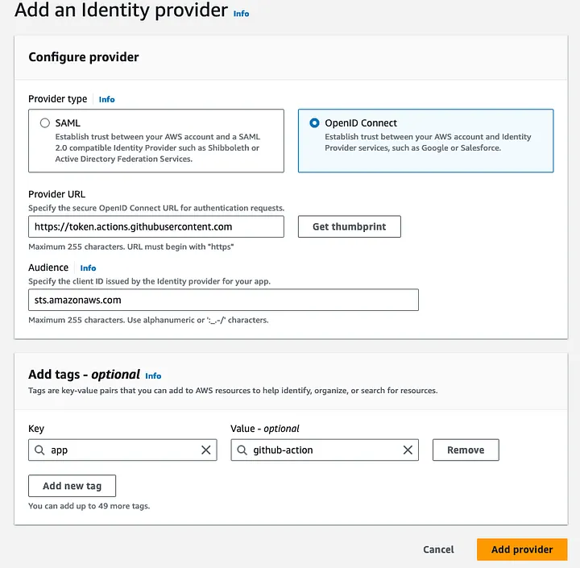
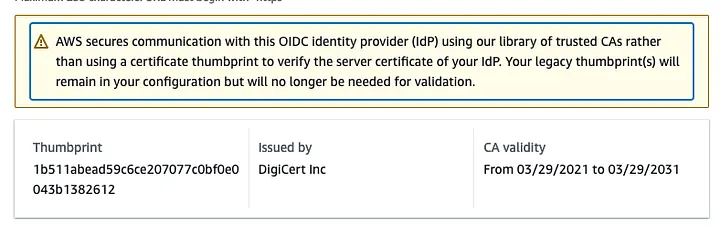
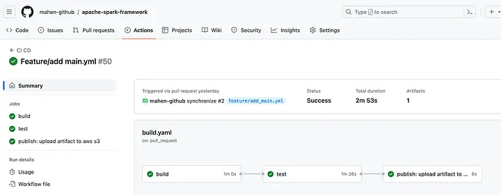

**Step 1: Create an OIDC provider in your account**

The first step in this process is to create an OIDC provider which you will use in the trust policy for the IAM role used in this action.

**1. Adding the identity provider to AWS**

Open AWS Console -> Identity and Access Management (IAM) -> Identity providers -> Add Provider

References: AWS documentation & configure-aws-credentials

    Audience:sts.amazonaws.com
    Provider URL: https://token.actions.githubusercontent.com



**2. Creating a role for web identity or OIDC**

Create an AWS IAM role that you want to assume after authenticating through OIDC. This role will specify the permissions and policies for your AWS resources. For instance, github_s3_copy_action

AWS_DEV_GITHUB_ACTION_ROLE = arn:aws:iam::XXXXXXXXX:role/github_s3_copy_action

**3. Configuring a role for GitHub OIDC identity provider**

Define a trust relationship in the IAM role’s policy document that specifies the OIDC identity provider as a trusted entity. The trust relationship document specifies who can assume the role.

Replace XXXXXXXXXXXXXX with your AWS accountID

"Federated": "arn:aws:iam::XXXXXXXXXXXXXX:oidc-provider/token.actions.githubusercontent.com" 

"token.actions.githubusercontent.com:sub": "repo:mahen-github/apache-spark-framework:*"

Example Trusted Policy

{
 "Version": "2012-10-17",
 "Statement": [
  {
   "Effect": "Allow",
   "Principal": {
    "Federated": "arn:aws:iam::XXXXXXXXXXXXXX:oidc-provider/token.actions.githubusercontent.com"
   },
   "Action": "sts:AssumeRoleWithWebIdentity",
   "Condition": {
    "StringEquals": {
     "token.actions.githubusercontent.com:aud": "sts.amazonaws.com"
    },
    "StringLike": {
     "token.actions.githubusercontent.com:sub": "repo:mahen-github/apache-spark-framework:*"
    }
   }
  }
 ]
}

**4. AWS Permissions**

Add permissions to the IAM role to access AWS resources. For instance, AmazonS3FullAccess. You may attach AWS policies to the role.
**Step 2: Create secrets and configuration variables in GitHub**

Securely store the IAM role created as Project Secrets and utilize Contexts to access these secrets in the workflow YAML file. Additionally, define variables for the S3 Path to copy artifacts to the GitHub repository.

    Create secrets: For instance, secrets.AWS_DEV_GITHUB_ACTION_ROLE
    Create Variables: Add the S3 Path to copy the artifact to github repository variables vars.AWS_S3_PATH

AWS_DEV_GITHUB_ACTION_ROLE = arn:aws:iam::XXXXXXXXX:role/github_s3_copy_action

AWS_S3_PATH = s3://<S3_BUCKET>

**Step 3: Configure the Workflow Configuration**

    using the GitHub Action aws-actions/configure-aws-credentials@v4

Publish Stage looks like this:
```text
  # https://github.com/aws-actions/configure-aws-credentials
  publish:
    name: "publish: upload artifact to aws s3"
    needs: test
    runs-on: ubuntu-latest
    # These permissions are needed to interact with GitHub's OIDC Token endpoint.
    permissions:
      id-token: write
      contents: read
    steps:
      - name: Download a single artifact
        # https://github.com/actions/download-artifact
        uses: actions/download-artifact@v3
        id: download-artifact
        with:
          name: apache-spark-framework-artifact
          path: build/libs
      - name: Configure AWS credentials from Test account
        uses: aws-actions/configure-aws-credentials@v4
        with:
          role-to-assume: ${{ secrets.AWS_DEV_GITHUB_ACTION_ROLE }}
          aws-region: us-west-2
      - name: Copy files to the test website with the AWS CLI
        run: |
          ls -lrt ${{steps.download-artifact.outputs.download-path}}
          aws s3 sync ${{steps.download-artifact.outputs.download-path}} ${{ vars.AWS_S3_PATH }}
          aws s3 ls ${{ vars.AWS_S3_PATH }}
          echo "🍏 This job's status is ${{ job.status }}."
```

**Step 4: Execute the workflow**

Upon creating a pull_request & push, the workflow under .github/workflows/ is executed.

on:
  pull_request:
    branches: main
  push:
    branches: main


**Conclusion**

The integration of GitHub Actions using OIDC provider with AWS enables the workflows to access resources in Amazon Web Services (AWS) without needing to store the AWS credentials as long-lived GitHub secrets. By eliminating the need to store long-term credentials and leveraging dynamic IAM roles, this approach significantly reduces the risk of credential exposure and enhances overall security posture. GitHub users benefit from streamlined access management, simplified credential rotation, and reduced maintenance overhead. Moreover, adherence to best practices such as zero-trust principles and least privilege access ensures a strong foundation for cloud security. In summary, the synergy between GitHub and AWS empowers organizations to achieve secure, efficient, and compliant access to cloud resources while mitigating potential vulnerabilities and maintaining operational agility.
